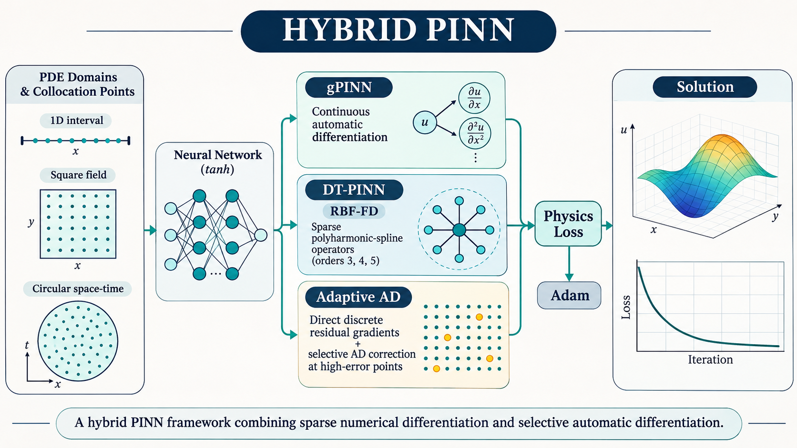

# Hybrid PINN: gPINN, DT-PINN, and Adaptive RBF-FD Methods

A standalone PyTorch research implementation for comparing seven physics-informed
neural-network formulations on a shared set of PDEs, collocation clouds, network
backbones, training loops, and evaluation rules.



The central question is simple: **how much automatic differentiation is actually
needed to train an accurate PINN?** This repository places fully continuous gPINN,
sparse numerical differentiation, and selective AD correction behind one interface
so their numerical behavior and cost can be studied under controlled conditions.

## What is implemented

All methods use the same tanh MLP and deterministic full-batch Adam pipeline. They
differ only in how the PDE residual and its coordinate gradients are evaluated.

| Method | PDE derivatives | Residual-gradient penalty | AD correction points |
| --- | --- | --- | --- |
| `gpinn` | PyTorch AD at every eligible point | AD | All points |
| `dt3` | PHS RBF-FD, order 3 | None | None |
| `dt4` | PHS RBF-FD, order 4 | None | None |
| `dt5` | PHS RBF-FD, order 5 | None | None |
| `direct` | Sparse PHS RBF-FD | Direct analytical discretization | None |
| `adaptive` | Sparse PHS RBF-FD | Direct discretization | Refreshed from an error indicator |
| `fixed` | Sparse PHS RBF-FD | Direct discretization | Fixed, evenly spaced subset |

The `direct`, `adaptive`, and `fixed` paths discretize the analytically derived
residual-gradient expressions. They do **not** use `D @ residual` as a substitute.
For time-dependent PDEs, RBF-FD acts only in space; time derivatives and the hybrid
correction terms remain differentiable PyTorch AD operations.

The adaptive selector combines two signals:

1. Half of the correction budget targets the largest disagreement between the
   order-3 and order-4 discrete Laplacians.
2. Half rotates deterministically through the candidate set to preserve coverage.

This makes `adaptive` both error-sensitive and reproducible. The `fixed` method
uses the same hybrid loss, making it a direct control for the selection strategy.

## Supported PDEs

| CLI name | Domain | Type | Reference error reported |
| --- | --- | --- | --- |
| `poisson1d` | Interval \([0, \pi]\) | Steady Poisson | Relative L1 and L2 |
| `poisson2d` | Unit square | Steady Poisson | Relative L1 and L2 |
| `burgers` | \([-1,1] \times [0,1]\) | Time-dependent Burgers | No independent reference array |
| `allen_cahn` | \([-1,1] \times [0,1]\) | Time-dependent Allen-Cahn | No independent reference array |
| `heat` | Unit disk \(\times [0,1]\) | Manufactured heat equation with Robin data | Relative L1 and L2 |

Poisson, Burgers, and Allen-Cahn use hard output transformations for prescribed
boundary/initial conditions. The disk heat problem applies its initial and Robin
conditions through the loss, using method-consistent normal derivatives.

## Quick start

Python 3.11 or newer is recommended.

```bash
git clone <repository-url>
cd standalone_hybrid_pinn
python -m venv .venv
```

Activate the environment, then install the pinned dependencies:

```bash
# Linux or macOS
source .venv/bin/activate

# Windows PowerShell
.venv\Scripts\Activate.ps1

python -m pip install --upgrade pip
python -m pip install -r requirements.txt
```

Run the verification suite:

```bash
python -m unittest discover -s tests -p "test_*.py" -v
```

Start with a ten-step smoke run:

```bash
python train.py --method adaptive --problem poisson1d --smoke-test
```

Then launch a full experiment:

```bash
python train.py --method adaptive --problem poisson1d --steps 20000 --seed 200
```

## Training examples

```bash
# Fully AD gradient-enhanced PINN
python train.py --method gpinn --problem poisson1d

# Order-specific DT-PINN baselines
python train.py --method dt3 --problem poisson2d
python train.py --method dt4 --problem burgers
python train.py --method dt5 --problem heat --dtype float64

# Direct and hybrid variants
python train.py --method direct --problem poisson1d
python train.py --method adaptive --problem burgers --correction-count 40
python train.py --method fixed --problem heat --device cuda
```

The complete command-line interface is available with:

```bash
python train.py --help
```

Important options include:

| Option | Default | Purpose |
| --- | --- | --- |
| `--steps` | `20000` | Adam optimizer updates |
| `--seed` | `200` | Deterministic Python, NumPy, and PyTorch seed |
| `--device` | `cpu` | PyTorch device, for example `cpu` or `cuda` |
| `--dtype` | `float32` | `float32` or `float64` |
| `--learning-rate` | Problem/method-specific | Override the Adam learning rate |
| `--lambda-weight` | Problem-specific | Residual-gradient weight |
| `--beta` | `1.0` | Weight of the hybrid AD correction |
| `--correction-count` | Problem-specific | Number of hybrid correction points |
| `--adapt-every` | `250` | Adaptive selection refresh interval |
| `--log-every` | `100` | Metric observation interval |
| `--output-dir` | `outputs` | Parent directory for run artifacts |
| `--smoke-test` | off | Cap a run at 10 optimizer steps |

If no learning rate is supplied, gPINN and DT-PINN use `1e-3`; the direct and
hybrid variants retain their problem-specific defaults. Seeds 200, 201, and 202
are convenient independent deterministic runs.

## Seven-method comparison

The dedicated driver runs every method for 20,000 steps on the same Poisson-1D
problem, seed, nodes, architecture, and manufactured reference. Unlike normal
training, it records the relative errors after every optimizer update.

```bash
python tests/test1.py
```

Use a smaller step count for a pipeline check:

```bash
python tests/test1.py --steps 10 --output-dir outputs/comparison_smoke
```

The comparison produces a CSV and JSON summary, per-method histories and
checkpoints, plus combined loss and relative-error plots.

## Outputs and metric semantics

A normal run is written to:

```text
outputs/<problem>_<method>_seed<seed>/
├── config.json
├── operator_diagnostics.json
├── history.csv
├── history.jsonl
├── training_loss.png
├── checkpoint_final.pt
├── checkpoint_best_observed_reference_l2.pt  # when a reference exists
└── run_summary.json
```

Metric schema version 2 records loss and relative errors from the same model state
**after** the reported optimizer update. Relative errors are evaluated on
independent deterministic samples that are never used for training or point
selection:

- 2,048 midpoint nodes for Poisson 1D;
- an 80 × 80 midpoint grid for Poisson 2D;
- 24 equal-area radii × 64 angles × 20 midpoint times for heat.

These are discrete relative norms rather than exact continuum integrals. The
`checkpoint_best_observed_reference_l2.pt` checkpoint is selected retrospectively
from logged states. It is a diagnostic—not early stopping or an independently
validated model-selection procedure.

Timing fields separate operator construction, optimizer updates, adaptive point
selection, evaluation, and total process time. CUDA timing is synchronized at the
optimizer and adaptation boundaries.

## Numerical formulation

For a derivative of order \(s\) and requested approximation order \(p\), the local
polynomial degree is

\[
q = p + s - 1.
\]

The nominal stencil contains \(2\binom{q+d}{d}+1\) neighbors in \(d\) spatial
dimensions. Coordinates are centered and scaled by the farthest stencil radius.
The polyharmonic-spline exponent is the smallest odd integer at least as large as
\(q\), clipped to `[5, 11]`.

Construction is deliberately strict:

- a rank-deficient nearest-neighbor stencil is expanded one point at a time;
- no pseudoinverse is silently substituted;
- duplicate clouds, non-finite systems, and unresolved rank failures raise errors;
- the default condition-number ceiling is `1e12`;
- normalized backward error must be at most `1e-12`;
- normalized polynomial reproduction error must be at most `1e-7`.

Operators are assembled in float64 before conversion to the training dtype.
Third derivatives can suffer cancellation in float32, so use `--dtype float64`
for accuracy studies.

### Collocation assumptions

Some original cloud sizes were unavailable, so this standalone implementation
uses deterministic replacements:

- Poisson 1D: 129 uniform nodes;
- Poisson 2D: a 21 × 21 Cartesian cloud;
- Burgers and Allen-Cahn: 65 spatial nodes × 25 time levels;
- Heat: a 441-point, 10-ring physical disk cloud with two ghost rings, giving
  601 spatial support points, across 25 time levels.

For the heat problem, ghost points support spatial stencils only. Robin normal
derivatives use the selected discrete operator for DT/direct/hybrid methods and AD
for gPINN. These choices preserve the algorithmic comparison but do not claim to
reproduce an unavailable upstream point cloud or optimizer trajectory exactly.

## Project layout

```text
.
├── train.py                  # CLI, training, metrics, checkpoints, plots
├── methods.py                # Seven losses and correction selectors
├── problems.py               # PDEs, clouds, constraints, operator routing
├── networks.py               # Tanh MLP and hard output transforms
├── rbf_fd.py                 # PHS RBF-FD construction and diagnostics
├── tests/
│   ├── test_methods.py       # Numerical and end-to-end verification
│   ├── test_reporting.py     # Metric/checkpoint reporting checks
│   └── test1.py              # Long seven-method comparison
├── docs/assets/              # README graphical abstract
└── requirements.txt
```

The test suite covers smooth first-, second-, third-, and mixed-derivative
operators; polynomial reproduction; Burgers residual-gradient formulas; hard
constraints; both selectors; gradient flow; every training path on steady and
time-dependent PDEs; disk/Robin handling; and the distinct DT orders.

## Reproducibility notes

- Normal runs construct only the operators needed by the selected method; gPINN
  constructs none.
- Supplying an existing problem to `run_training` explicitly reuses its operator
  bank and reports zero current-run construction time.
- A nonempty run directory is never overwritten. Choose a new `--output-dir`.
- Generated outputs, checkpoints, and preserved legacy artifacts are ignored by
  Git. Historical metrics use an older grid and pre-update loss convention and
  must not be pooled with schema-version-2 results.
- Compare solution errors as well as training loss: the methods optimize different
  objectives, and some use different default learning rates.

## Citation and license

No publication citation or software license is currently declared. Add both
before redistributing the project or using it as a release artifact.
